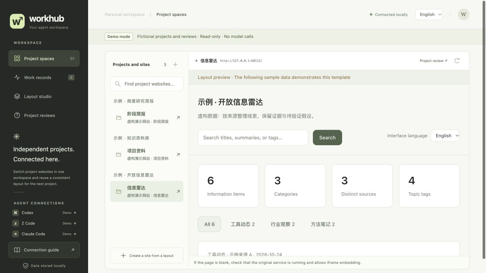
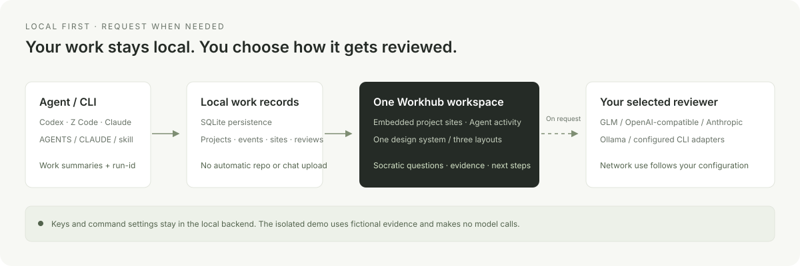

[简体中文](README.md) | [English](README.en.md)

# Workhub

**One workspace for projects, agents, and better questions.**

Workhub is a local-first project console. Switch between project websites without leaving a shared workspace, keep a record of what different agents actually did, and use evidence-based Socratic reviews to examine goals, assumptions, gaps and next steps. One design system connects the portal and three reusable layouts, so moving between projects feels familiar.



> All screenshots use an isolated demo with fictional projects, activity and reviews. The demo makes no model calls and does not read real projects or credentials. Some screenshots and example content remain in their original language; switching the interface does not rewrite project content.

## What it brings together

| Area | Purpose |
| --- | --- |
| **Project spaces** | Connect existing static sites or running local services, then read and interact with them beside persistent portal navigation. |
| **Work records** | Track projects, agents, task states, artifacts and verification summaries. Independent `run-id` values keep concurrent tasks separate. |
| **Project archives** | Preserve the actual agent, verifiable sessions, project-specific prompt versions and deliverables, linking sources to outputs. |
| **Layout studio** | Radar, Library and Brief share typography, colors, spacing and controls while organizing different kinds of information. |
| **Project reviews** | Examine five dimensions through six kinds of Socratic questions. Distinguish evidence, untested assumptions, blind spots and next actions; add answers and review again. |

## Quick start

Use **Python 3.10 or newer**. The core server uses the standard library and the interface uses plain HTML, CSS and JavaScript. Node.js and frontend dependencies are not required to run it.

```sh
git clone https://github.com/8eeth0ven/workhub.git
cd workhub
python3 workhub.py serve --port 8787
```

Open [http://127.0.0.1:8787](http://127.0.0.1:8787). **Recording work, viewing project websites and using templates do not require a model API key.** Only project reviews need a configured reviewer.

To explore a populated interface first, run the isolated demo:

```sh
python3 examples/demo.py --port 8899
```

Open [http://127.0.0.1:8899](http://127.0.0.1:8899). The demo uses a temporary SQLite database, four fictional projects and three sample websites. It does not read your database, global Agent configuration or model credentials. Reviews are clearly labeled preset examples, and real model calls are disabled. Temporary data is removed when the demo exits.

See [Installation](docs/installation.en.md) for setup, optional background services and moving a checkout.

## Switch between English and Simplified Chinese

Use the **简体中文 / English** selector in the top toolbar. Your choice is saved locally in the browser for the current Workhub origin and restored after a refresh. It changes navigation, controls, status labels and interface messages while keeping the current page, selected site, filters and unfinished input.

Project names, work records, website content and existing model reviews stay in their original language. Supported template iframes receive the portal's language choice; third-party websites keep their own language behavior. Documentation has matching language links at the top of each translated page. CLI commands, API paths and stored data are unchanged by the interface setting.

The **Color theme** selector offers eight light palettes: Moss, Mist blue, Graphite, Warm sand, Orange, Celadon, Rose and Indigo. The preference is saved locally. Palettes change colors while keeping the same layout, typography, controls and project state; text and primary buttons remain readable. Switching never reloads project frames, rewrites records or invokes a model.

The local directory server injects the restricted palette runtime and shared CSS; compatible templates follow the portal too. Generic embedded styles are color-only: they do not alter font sizes, layout, images, PDFs, video or charts. Native applications can set `body[data-workhub-native]` to skip generic overrides and map their own exact color variables.

Applications with their own backend can explicitly load these resources in their page:

```html
<link rel="stylesheet" href="http://127.0.0.1:8787/design-system.css">
<link rel="stylesheet" href="http://127.0.0.1:8787/embedded-theme.css">
<script defer src="http://127.0.0.1:8787/embedded-theme.js"></script>
```

The child runtime trusts only its actual parent at `http://127.0.0.1:8787` by default and requests the current palette through a ready/request handshake. For a custom port or a `localhost` alias, explicitly set an HTTP(S) loopback origin such as `data-workhub-parent-origin="http://127.0.0.1:8899"` on the script tag and update the resource URLs. Arbitrary referrers are not trusted. Third-party pages that have not opted in are not forced through cross-origin DOM manipulation. Directory pages can disable automatic injection with `?workhub_theme=original`.

## Connect your agents' work

Workhub provides a CLI, one shared skill, and required-reading entries in `AGENTS.md` and `CLAUDE.md`. The installer preserves existing rules and backs up files before changing them. Projects can share a protocol rather than maintaining a separate one for every agent.

```sh
# Install discovery and instruction entries for the current user.
python3 scripts/install.py --global

# Add instruction entries to one project and register it.
python3 scripts/install.py --project /path/to/your-project
```

Agents that actually load these entries—including Codex, Z Code and Claude Code—can follow the same protocol for starting work, recording progress, completing tasks and reporting blockers. Existing sessions may need to reload their instructions. Other machines and cloud environments need their own setup. Compatibility entries do not imply that every client and version has been tested.


You can also use the CLI directly:

```sh
python3 workhub.py register --path /path/to/your-project --name "My project"
python3 workhub.py record --project /path/to/your-project --agent codex \
  --run-id my-task-001 --status running --task "Organize project material" \
  --summary "Started organizing sources and defining verification scope"
python3 workhub.py events --project /path/to/your-project
```

Record work that actually happened. `completed` means that particular task finished; it does not declare the entire project permanently complete. Cloning the repository or serving the interface does not install global rules, start a background service or call a model.

## Keep agents, prompts and deliverables with the project

Project archives use `archive-session`, `archive-prompt` and `archive-artifact` to retain execution and session provenance, original task prompts and deliverable snapshots. Prompts are versioned by project and purpose. Rewritten instructions are marked `derived` and linked to the original UUID rather than overwriting the user's words. Full conversations and credentials are not retained, and original prompts are not sent to a model reviewer by default.

Snapshots follow a selected entry and its local dependencies. Editor copies and other attachments are explicitly selected; sibling articles in a shared directory are not archived automatically. Distinguish a draft, a checked deliverable and a platform publication by evidence. Without a publication receipt, keep `unknown`: local HTML, complete images or a successful model call do not establish publication or project acceptance. Use `archive-list` to inspect a project's archive. See [Project archives](docs/project-archive.en.md) for commands and data boundaries.

## Independent sites, a consistent reading experience

Connect an existing static site by directory or a running development server by its local URL. Directory sites receive independent local preview origins, while the portal keeps its navigation around the embedded page. If a site forbids iframe embedding, adjust the configuration of a site you control or connect its static build instead.

The project list includes registered projects with and without websites. A project without a website opens its record details and is clearly labeled; it is not presented as a working site. Registering a real directory or URL adds the website beneath that project automatically. Collapsing the surrounding interface expands the current website to fill the window without reloading it.

New projects can start from three layouts with a shared visual system:

```sh
python3 scripts/site_templates.py create --template radar --language en \
  --output /path/to/your-project/site --name "Project radar"
python3 scripts/install.py --project /path/to/your-project \
  --site-dir /path/to/your-project/site --site-name "Project radar" --template radar
```

| Layout | Best suited to |
| --- | --- |
| `radar` | Leads, sources, ongoing information collection and changing signals. |
| `library` | Reference material, documents and a searchable resource collection. |
| `brief` | Findings, supporting evidence, progress and concise reports. |

Generated sites start without demo entries. Use `--language en` to choose English as the initial interface language, or `--language zh-CN` for Simplified Chinese (the default); an existing browser language preference takes priority. `python3 scripts/site_templates.py list --language en` lists the available layouts in English. Creating a site and registering it with the portal are separate steps. Shared visual tokens remain consistent across layouts; a sidebar title is not repeated as a large heading in the content area.


## Better project judgments start with better questions

A reviewer reads registered project material; it does not automatically audit the repository. Reviews organize the available evidence around goals, evidence, verification, risks and next steps. Follow-up questions examine clarification, assumptions, evidence, alternative perspectives, consequences and the question itself.

Unknown scores stay **unrated**. Insufficient evidence means a judgment is not yet supported, not that the project is poor. New work records mark older reviews as needing an update. Questions include both a reason for asking and a suggested way to verify an answer, turning review into practical follow-up rather than a decorative score.

Deeper reviews follow **specific claim → original evidence → counterexamples or gaps → verification action → review again**. A conclusion needs a checkable source; an unresolved question needs an executable check. Record the actual result before revisiting the conclusion. A successful model call does not mean the project passed acceptance, and a recommendation is not an action already performed.

Supported adapters include **GLM, OpenAI-compatible Chat Completions, Anthropic, Ollama and an explicitly configured local CLI wrapper**. API services use credentials as configured; Ollama and CLI adapters may not need an API key. A CLI adapter runs a command you configured—it does not install another client or sign you into it.

The adapters implement bounded protocols, not universal compatibility. The OpenAI-compatible adapter does not implement the Responses API, tool calls or streaming. Interactive CLI output needs a wrapper that follows Workhub's JSON input/output contract. See [Providers and reviewers](docs/providers.en.md) for examples, legacy GLM compatibility and adapter limitations. Supporting a protocol does not mean every third-party endpoint or CLI version has been tested.


The examples above are read-only fictional results, generated without calling a model. The real workflow keeps evidence references, review history and stale-result indicators; a model's recommendation is not a completed verification.

## CLI, API and model boundaries

The CLI handles registration, records, website connections and review requests. The loopback HTTP API serves the same portal workflow; switching model providers does not require different frontend routes. Provider credentials, command arguments and working directories are configured in the local backend, not supplied by browser review requests.

Model adapters validate the returned review structure and evidence references. Timeouts, output limits, bounded retries and concurrency limits are configurable. Failed calls and unsupported responses remain failures; Workhub does not replace them with invented model judgments. Tests use simulated responses, temporary local HTTP servers and temporary wrappers rather than claiming live validation of every provider.

## How data moves



- Project records are stored locally in `~/.local/share/agent-workhub/workhub.sqlite3` by default. Set `AGENT_WORKHUB_HOME` to use a different location.
- `llm.json`, credentials and CLI configuration stay in the local backend. They are not sent to the browser and should not be committed to Git.
- A review sends the selected reviewer a limited project name, description, recent work summaries, site summaries and additional background. It does not automatically upload the repository, full conversations or website files.
- A remote review API receives these summaries. Whether a CLI or local model connects to other services depends on its own configuration.

See [Privacy](docs/privacy.en.md) for data boundaries, demo isolation and release checks. Automatic redaction helps remove known credentials; it cannot guarantee that every sensitive detail has been removed.

## Development and verification

```sh
python3 -m unittest discover -s tests -v
python3 scripts/audit_release.py
```

Tests use temporary data and simulated reviewers. Demo isolation tests check that API responses do not expose local paths, global configuration is not read, and real model calls cannot be triggered. Verify real models, external CLI wrappers and browser compatibility in your own environment.

Run `node tests/test_i18n.cjs` for the standalone interface-language checks. That development check requires Node.js; running Workhub itself does not.
