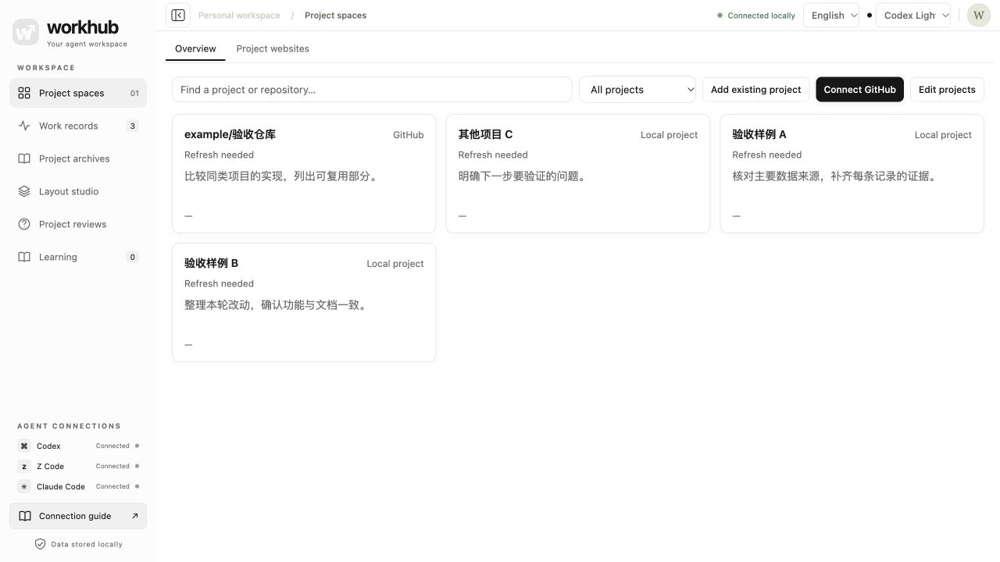

[简体中文](README.md) · [English](README.en.md)

# Workhub

Switch between project sites, see the latest Git and agent activity, and save the next action for each project in one local workspace.



Use Python 3.10 or later to start the service from the repository root.

```sh
python3 workhub.py serve --port 8787
```

Open the address printed in the terminal, choose **Add existing project**, then select a local folder. To try it with fictional projects first, run `python3 examples/demo.py --port 8899`.

Cards open full details; returning keeps filters. Use **Edit projects** to select visible entries and remove them from the workspace in a batch. Local files, websites, work records and remote repositories remain intact.

Work records live in a local SQLite database. Browsing needs no model key. When you request a project review, the configured API, model or CLI receives the selected summary and context.

[Installation and agent setup](docs/installation.en.md) · [GitHub snapshots and project tracking](docs/project-control.en.md) · [Model configuration](docs/providers.en.md) · [Data and privacy](docs/privacy.en.md) · [Optional modules](https://github.com/8eeth0ven/workhub-model)
