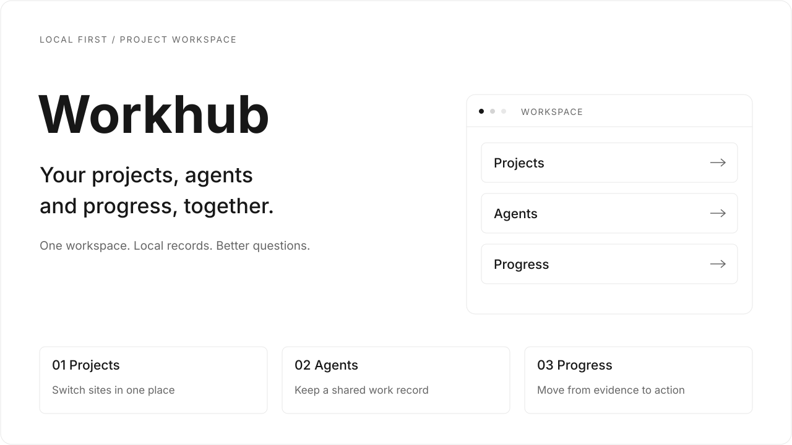
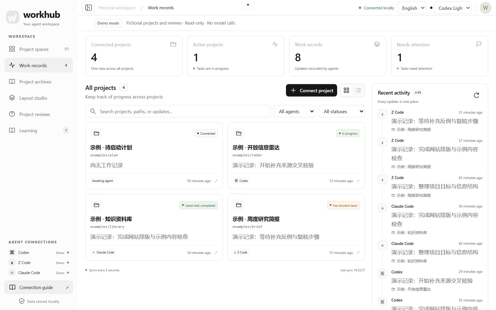
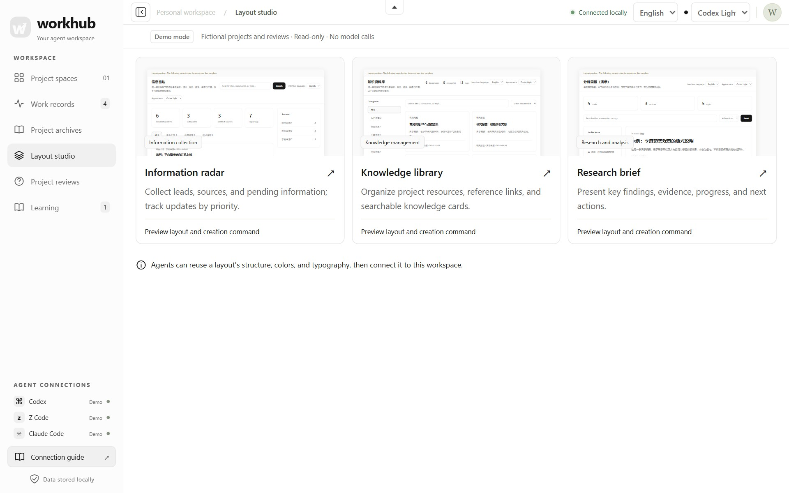
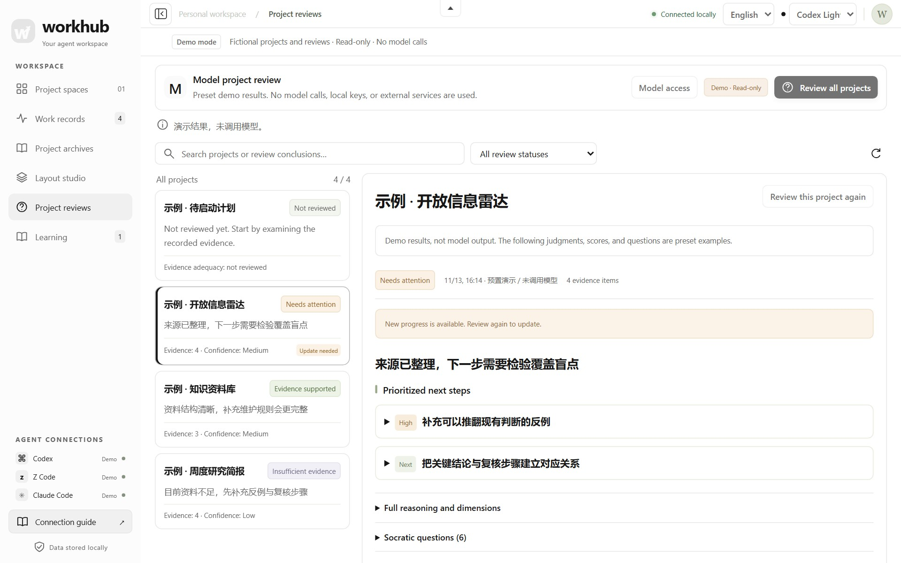
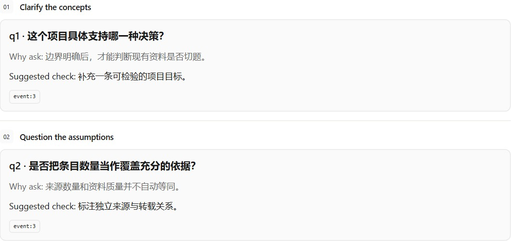
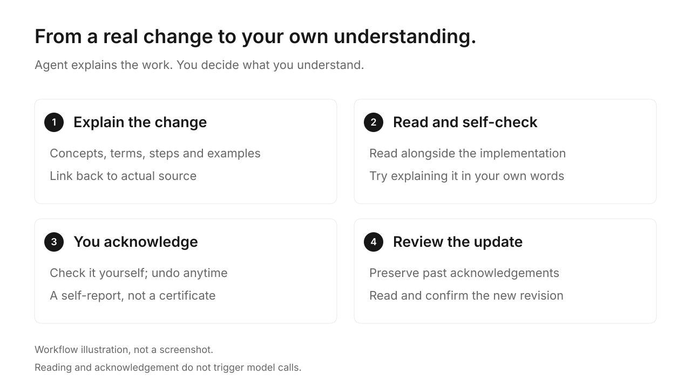

[简体中文](README.md) | [English](README.en.md)



**A local-first workspace for project websites, agent activity and next steps.**

Switch projects in one place, see what different agents actually did, and connect prompts with deliverables. When needed, use Socratic reviews to examine evidence, assumptions and gaps. The core server uses the Python standard library; the frontend is plain HTML, CSS and JavaScript.

[Quick start](#quick-start) · [Screenshots](#screenshots) · [Connect projects](#connect-projects-and-agents) · [Documentation](#documentation)

## Quick start

Use **Python 3.10+**. Node.js and frontend dependencies are not required to run Workhub.

```sh
git clone https://github.com/8eeth0ven/workhub.git
cd workhub
python3 workhub.py serve --port 8787
```

Open [http://127.0.0.1:8787](http://127.0.0.1:8787). **Recording work, viewing sites and using templates do not require a model key.** Project reviews need a separately configured reviewer. On Windows, use `python` if `python3` is unavailable.

<details>
<summary>Explore a populated interface with the isolated demo</summary>

```sh
python3 examples/demo.py --port 8899
```

Open [http://127.0.0.1:8899](http://127.0.0.1:8899). The demo uses a temporary database, four fictional projects, three example sites and preset reviews. It does not read real projects, user configuration or credentials, and makes no model calls. Temporary data is removed on exit.

</details>

## Six areas, one workspace

| Area | What you can do |
| --- | --- |
| **Project spaces** | Switch existing sites in one workspace and give project content the main canvas. |
| **Work records** | Track projects, agents, task states, artifacts and checks; distinguish concurrent tasks with `run-id`. |
| **Project archives** | Link agents, verifiable sessions, original prompt versions and deliverables. |
| **Learning** | Revisit concepts, terminology and actual source; acknowledge understanding yourself and review updates. |
| **Layout studio** | Start with Radar, Library or Brief while keeping one design system. |
| **Project reviews** | Check goals, assumptions, gaps and next actions against evidence; add answers and review again. |

## Screenshots

Every interface screenshot uses **Codex Light**: white surfaces, neutral text and fine gray borders. Screenshots come from an isolated demo with fictional projects and reviews. Images use landscape composition. Covers and workflow diagrams are SVG illustrations. Project content keeps its original language when the interface changes.


<details>
<summary>View work records, layouts and project reviews</summary>

**Work records** — inspect recorded activity by project and agent.



**Layout studio** — one design system, three ways to organize information.



**Project reviews** — connect existing evidence, open questions and suggested checks.





</details>



Only you check “I have a basic understanding,” and you can undo it. Updated content asks for another review while preserving earlier acknowledgements. Reading and acknowledging do not trigger model calls.

## Connect projects and agents

Run this in the Workhub checkout to add required-reading entries and register a project. The installer preserves existing rules and backs up changes.

```sh
python3 scripts/install.py --project /path/to/your-project
```

For a static site, add `--site-dir /path/to/your-project/site`. For a running development server, use `--site-url http://127.0.0.1:3000` instead. These options are mutually exclusive, and the URL must refer to a running service. If a site forbids iframe embedding, adjust the configuration of a site you control.

For a new site, generate a template first, then connect it using the command above. Generated sites contain no demo data by default.

```sh
python3 scripts/site_templates.py create --template radar \
  --output /path/to/your-project/site --name "Project radar"
```

Agents that actually load the project rules—including Codex, Z Code and Claude Code—can record starts, progress and completion through the same protocol. Existing sessions may need to reload; other machines need their own setup. See [Installation](docs/installation.en.md) and the [shared skill](skill/agent-workhub/SKILL.md) for commands.

## Appearance and reading

**Codex Light** is the default. The toolbar also offers **Codex Dark** and the existing palettes. English and Simplified Chinese share the same interface. Language and appearance changes preserve the selected site, filters and draft input without reloading project pages or rewriting content.

Long-form articles can stay light independently of the workspace. See [Appearance and embedded reading](docs/appearance.en.md) for theme integration, allowed parent origins and Markdown reading styles.

## Data and models


- Work records use local SQLite by default; set `AGENT_WORKHUB_HOME` to change the location. Credentials and command configuration stay in the backend.
- A requested review sends selected project summaries and additional context to the configured reviewer. It does not automatically upload the full repository, complete conversations or website files.
- Choose an API, local model or explicitly configured CLI adapter. Network use depends on its configuration. Cloning or serving the interface does not install global rules, start background services or call a model automatically.
- Review suggestions and learning acknowledgements are not project acceptance. `completed` means that task finished; publication states need actual evidence.

## Documentation

| Guide | Contents |
| --- | --- |
| [Installation](docs/installation.en.md) | Startup, agent integration, optional background services and migration |
| [Appearance and reading](docs/appearance.en.md) | Language, light/dark appearance, embedded themes and light articles |
| [Project archives](docs/project-archive.en.md) | Agents, prompt versions, deliverable snapshots and provenance |
| [Models and reviewers](docs/providers.en.md) | Configuration, supported adapters and validation limits |
| [Privacy and data](docs/privacy.en.md) | Local storage, selected outbound summaries and demo isolation |
| [Contributing](CONTRIBUTING.md) | Development conventions and release checks |

Before publishing, run `python3 scripts/audit_release.py` and `git diff --check`, and inspect the staged file list. The public repository excludes local databases, real project material, test artifacts and session logs.
