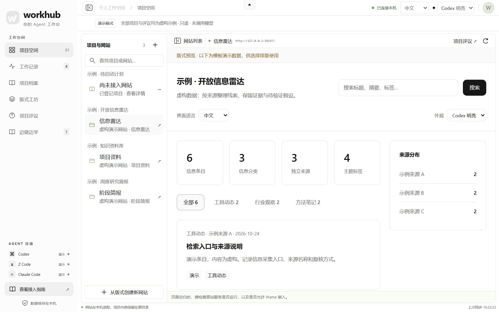
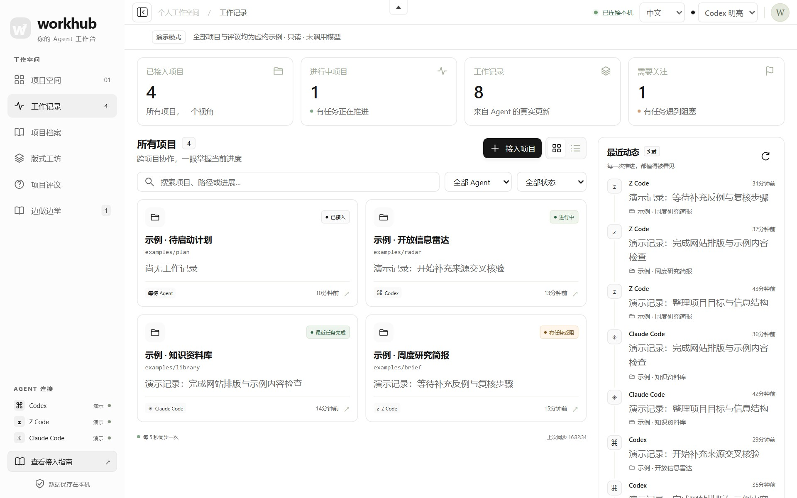
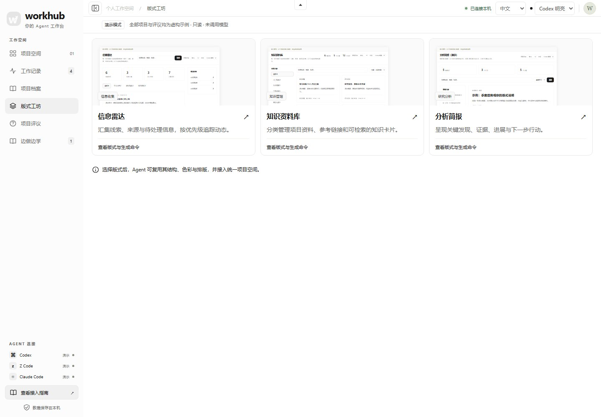
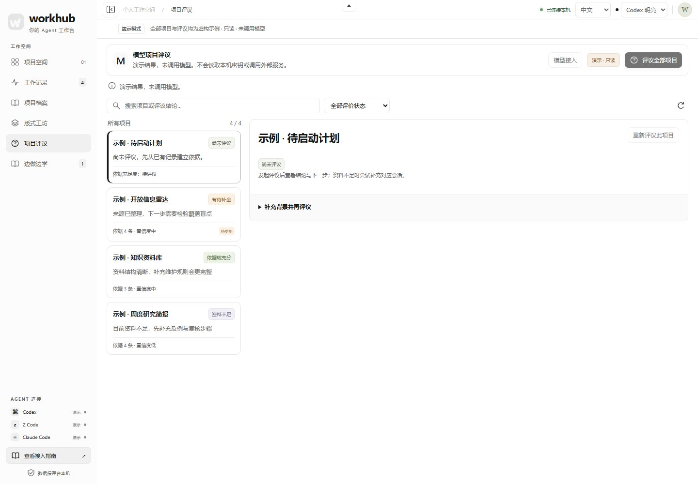
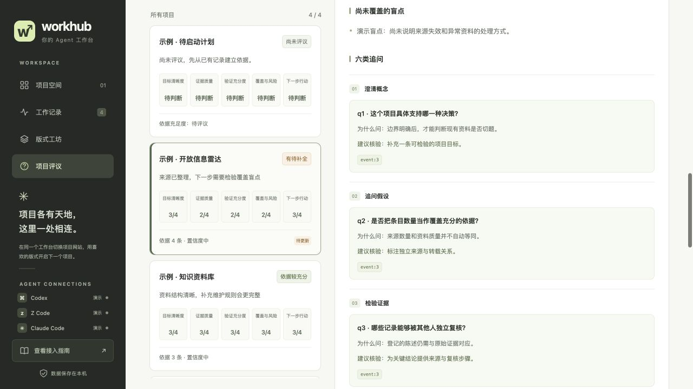
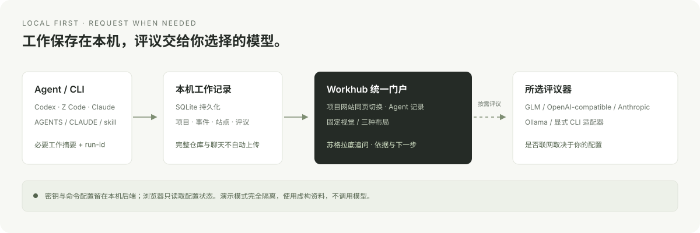

[简体中文](README.md) | [English](README.en.md)

# Workhub

**One workspace for projects, agents, and better questions.**

Workhub 是一个本地优先的项目中控台：在同一页面切换各项目网站，追踪不同 Agent 的工作记录，再用苏格拉底式评议检查目标、证据、假设与盲点。统一的视觉体系贯穿门户和三种项目布局，减少来回切换时的负担。



> 本文配图均来自隔离演示：项目、记录与评议都是虚构示例，未调用模型，也未读取真实项目或密钥。

## 它把什么放到一起

| 入口 | 用途 |
| --- | --- |
| **项目空间** | 把已有静态网站或本机运行服务接入门户，在常驻导航旁直接切换、阅读与操作。 |
| **工作记录** | 汇总项目、Agent、任务状态、产物和验证摘要；独立 `run-id` 区分并行任务。 |
| **项目档案** | 保留实际 Agent、可核实的会话、项目专属提示词版本与发布物，把来源和交付关联起来。 |
| **版式工坊** | 信息雷达、知识资料库、分析简报，共用字体、配色、间距和控件，只改变信息布局。 |
| **项目评议** | 围绕五个维度与六类追问，列出已有依据、未证实假设、盲点和下一步；支持补充回答后再评议。 |

## 快速上手

需要 Python 3.10 或更新版本。核心服务和前端使用标准库与原生 HTML/CSS/JavaScript，无需安装 Node.js 或前端依赖。

```sh
git clone https://github.com/8eeth0ven/workhub.git
cd workhub
python3 workhub.py serve --port 8787
```

打开 [http://127.0.0.1:8787](http://127.0.0.1:8787)。**没有模型密钥也能记录工作、看项目网站、使用模板。** 项目评议才需要配置评议器。

先体验完整界面，可以运行隔离演示：

```sh
python3 examples/demo.py --port 8899
```

打开 [http://127.0.0.1:8899](http://127.0.0.1:8899)。演示使用临时 SQLite、四个虚构项目与三个示例网站，不读取用户数据库、全局 Agent 配置或模型密钥；评议为明确标注的预置结果，禁止发起真实模型调用。退出时删除临时数据。

完整安装、后台运行与迁移说明见 [安装文档](docs/installation.md)。

## 中英文切换

顶部工具栏可选择「简体中文 / English」，语言偏好保存在当前门户来源的浏览器本地存储中，刷新后沿用。切换只改变导航、控件、状态标签与界面提示，不翻译或改写项目名称、工作记录、网站正文和已有模型评议；当前页面、站点、筛选与未提交输入保持不变。门户会把语言选择同步给支持该协议的模板 iframe，已有第三方网站保留自己的语言行为。

文档也可通过每页顶部入口在中英文之间切换。英文版见 [README.en.md](README.en.md)；CLI 命令、API 路径与持久化数据结构不因界面语言改变。

顶部「配色」可选择苔绿、雾蓝、石墨或暖沙，偏好在浏览器本地保存。颜色在整个门户中统一使用，布局、字号和项目状态保持不变；支持该协议的模板会同步配色，独立第三方网站保留原有样式。

## 把 Agent 的工作接进来

Workhub 提供 CLI、共享 skill，以及 `AGENTS.md` / `CLAUDE.md` 必读入口。安装器保留已有规则，并为修改内容备份；不是要求每个项目维护一套不同协议。

```sh
# 安装当前用户的全局入口
python3 scripts/install.py --global

# 为指定项目追加必读入口并登记项目
python3 scripts/install.py --project /path/to/your-project
```

接入后，读取这些入口的 Codex、Z Code、Claude Code 等 Agent 可按同一协议记录开工、进展、完成或阻塞。已有会话未必立即重新载入规则，其他机器或云端环境也需要单独接入。兼容入口不等于所有客户端、所有版本都已验证。



也可以直接使用 CLI：

```sh
python3 workhub.py register --path /path/to/your-project --name "我的项目"
python3 workhub.py record --project /path/to/your-project --agent codex \
  --run-id my-task-001 --status running --task "整理项目资料" \
  --summary "开始整理来源和验证范围"
python3 workhub.py events --project /path/to/your-project
```

记录表示实际发生的工作；`completed` 表示这次任务完成，不代表整个项目从此完工。

## 把执行者、提示词和交付留在项目里

项目档案通过 `archive-session`、`archive-prompt`、`archive-artifact` 保留执行者与会话来源、原始任务提示词和发布物快照。提示词按项目和用途保留版本，重构内容另标 `derived` 并关联原始 UUID，不覆盖用户原话；不保存完整聊天或凭据，原始提示词也不会默认发送给模型评议器。

发布物从主入口与本地依赖建立快照，编辑版等附加文件需显式选择，不会顺带归档共享目录中的兄弟文章。草稿、检查通过和平台发布按证据区分：没有发布凭证时保持 `unknown`，本地 HTML、图片齐全或模型调用成功都不能当成已经发布或验收通过。用 `archive-list` 查看项目档案，完整命令与数据边界见 [项目档案](docs/project-archive.md)。

## 网站各自独立，阅读体验保持一致

已有静态网站可按目录接入；已有开发服务器可按实际运行的本机 URL 接入。目录网站使用独立本机预览来源，门户保留导航，页面在内部切换。原站若禁止 iframe，需要调整自有站点的嵌入配置或接入静态目录。

项目列表同时显示有网站和尚未接入网站的登记项目。后者可直接打开项目记录详情，不会被当成可运行的网站；接入真实目录或 URL 后，入口会自动出现在该项目下面。收起外围界面时，当前网站自动铺满窗口；展开或收起控件不会重载当前网站。

新项目可以从固定视觉的三种布局开始：

```sh
python3 scripts/site_templates.py create --template radar \
  --output /path/to/your-project/site --name "项目雷达"
python3 scripts/install.py --project /path/to/your-project \
  --site-dir /path/to/your-project/site --site-name "项目雷达" --template radar
```

`radar` 适合线索与动态，`library` 适合参考资料，`brief` 适合阶段发现与简报。正式生成的站点默认不包含演示内容；生成页面和登记网站是两个步骤。 模板支持 `--language zh-CN` 或 `--language en` 指定初始界面语言；已有的浏览器语言偏好优先，独立站也可以在工具栏切换。



## 用问题补全项目判断

评议器读取已登记资料，而不是自动审计整个仓库。它按目标、证据、验证、风险与下一步组织评价，并从澄清、假设、证据、视角、后果与反思六类问题继续追问。未知分数保留为“待判断”；资料不足表示尚不能判断，不表示项目做得差。新工作记录会让旧评议显示为待更新。

深度评议按“具体主张 → 原始依据 → 反例/缺口 → 验证动作 → 再评议”闭环推进。每个结论要有可核对的来源，未决问题要对应实际可执行的检查；完成检查后再更新结论。成功调用模型不等于项目验收通过，建议也不等于已经执行。

支持配置 GLM、OpenAI-compatible、Anthropic、Ollama，或显式启用本机 CLI 适配器。API 服务按配置使用密钥；Ollama 和 CLI 可不需要 API Key。CLI 适配器执行你明确配置的现有命令，不会自动为你安装或登录其他客户端。

具体选项、`llm.json` 示例、旧 GLM 配置兼容和适配器限制见 [模型与评议器配置](docs/providers.md)。这些是支持的接入协议，不代表所有第三方端点或 CLI 版本均已实测。





每个追问都说明“为什么问”与“建议如何核验”，帮助把评价转化为下一步行动。上图为只读虚构演示，未调用模型。

## 数据如何流动



- 项目记录默认保存在本机 `~/.local/share/agent-workhub/workhub.sqlite3`，可通过 `AGENT_WORKHUB_HOME` 指定位置。
- `llm.json`、密钥与 CLI 命令配置留在本机后端，不发送给浏览器，也不应提交到 Git。
- 发起评议时，项目名称、描述、近期工作摘要、站点摘要与补充背景交给所选评议器；不会自动上传完整仓库、完整聊天或网站文件。
- 使用远端评议 API 会发送这些摘要。CLI 与本地模型是否联网，由其实际配置决定。

更多边界与演示隔离说明见 [隐私文档](docs/privacy.md)。

## 开发与验证

```sh
python3 -m unittest discover -s tests -v
```

测试使用临时数据和模拟评议器；演示隔离检查还会确认 API 不泄露本机路径、不读取全局配置且不能触发模型调用。真实模型、外部 CLI 和浏览器兼容性仍应在你的环境中验证。

界面语言的独立行为检查可运行 `node tests/test_i18n.cjs`。这项开发检查需要 Node.js，运行 Workhub 本身不需要。
