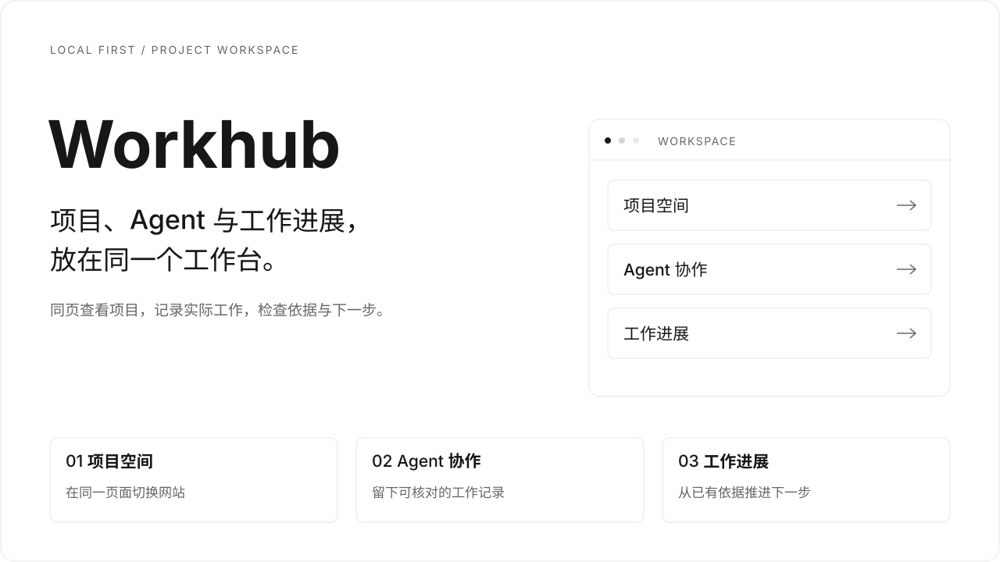
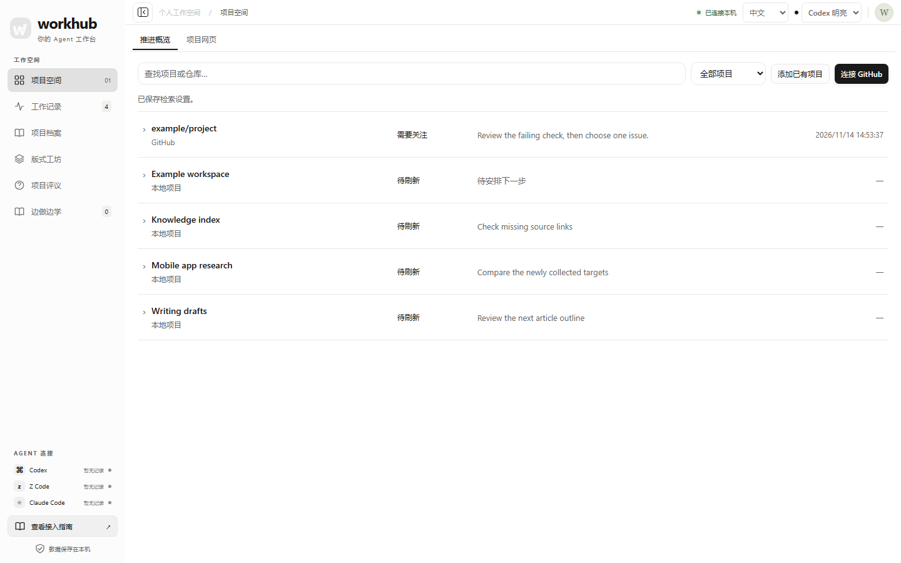
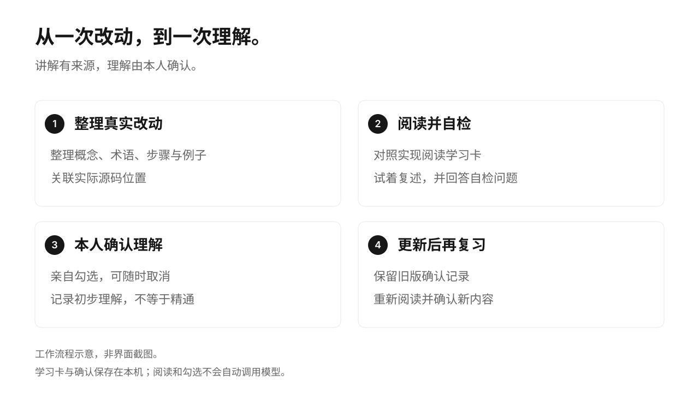
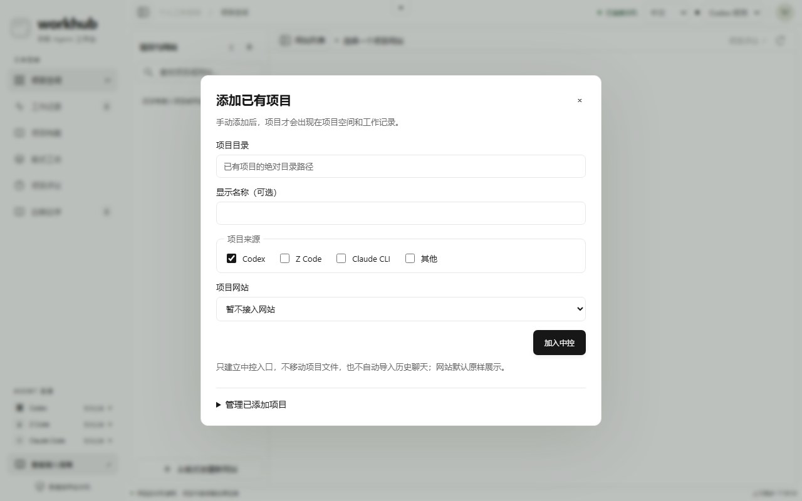
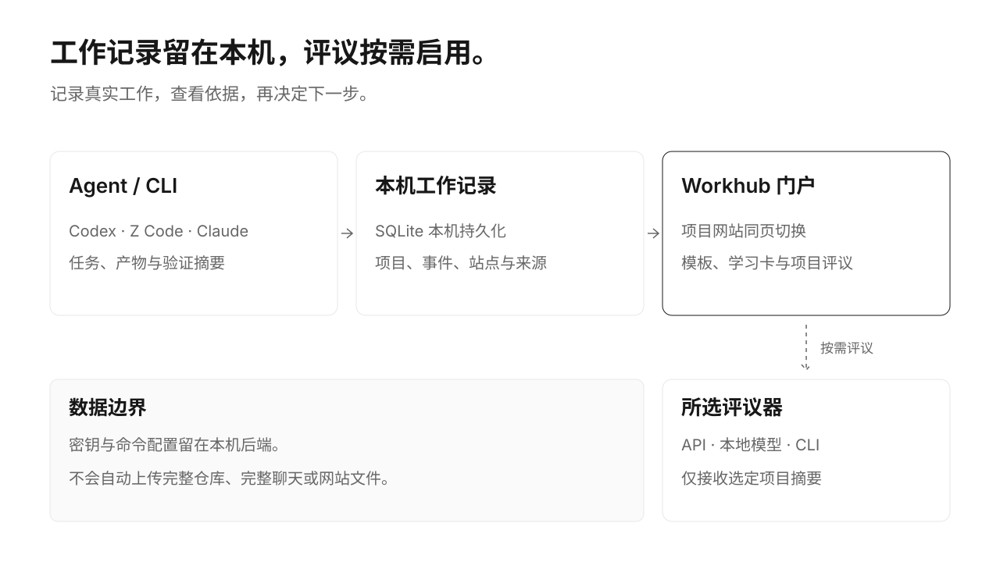

[简体中文](README.md) | [English](README.en.md)



**一个本地优先的多项目中控，连接 GitHub、本地项目、Agent 工作记录和下一步行动。**

在一个紧凑列表里查看需要关注的项目、保存下一步，再切回原项目网页继续工作。GitHub / Git 快照提供依据；项目详情可选择定时发现相似外部项目。需要时，再用已有项目评议检查假设和盲点。核心服务使用 Python 标准库，前端为原生 HTML/CSS/JavaScript。

[快速开始](#快速开始) · [界面预览](#界面预览) · [接入项目](#接入项目与-agent) · [文档导航](#文档导航)

## 快速开始

需要 **Python 3.10+**，运行时无需 Node.js 或前端依赖。

```sh
git clone https://github.com/8eeth0ven/workhub.git
cd workhub
python3 workhub.py serve --port 8787
```

打开 [http://127.0.0.1:8787](http://127.0.0.1:8787)，点击项目空间右上角 **添加已有项目**，从下拉框选择 Codex、Z Code 或 Claude CLI 的已有目录，也可手动填写。只有你手动添加的项目及其记录会显示；CLI 上报不会自动将目录加入中控。**记录工作、查看项目网站和使用模板不需要模型密钥**；项目评议需要单独配置评议器。Windows 可用 `python` 替换 `python3`。

<details>
<summary>先体验有内容的界面：运行隔离演示</summary>

```sh
python3 examples/demo.py --port 8899
```

打开 [http://127.0.0.1:8899](http://127.0.0.1:8899)。演示使用临时数据库、四个虚构项目、三个示例网站和预置评议，不读取真实项目、用户配置或密钥，不调用模型；退出后删除临时数据。

</details>

点击 **连接 GitHub** 可选择公开仓库或直接填写 `owner/repo`，加入后读取 PR、Issue 和对应默认分支 SHA 的检查。项目详情内的 **发现相似项目** 支持手动检索或可选 6 小时／每天／每周；默认关闭，服务运行期间执行。[使用与权限说明](docs/project-control.md)。

## 一个工作台，六个入口

| 入口 | 你可以做什么 |
| --- | --- |
| **项目空间** | 推进概览与原项目网页共用一个入口；展开项目查看快照、下一步和外部参考。 |
| **工作记录** | 查看项目、Agent、任务状态、产物与验证摘要；用 `run-id` 区分并行任务。 |
| **项目档案** | 关联执行者、可核实会话、原始提示词版本和交付物。 |
| **边做边学** | 回看概念、术语与实际源码，由本人确认理解，内容更新后再复习。 |
| **版式工坊** | 从信息雷达、知识资料库、分析简报三种布局开始，沿用统一设计。 |
| **项目评议** | 对照证据检查目标、假设、盲点与下一步，补充回答后继续评议。 |

## 界面预览

所有界面截图统一使用 **Codex 明亮**：纯白背景、黑灰文字与浅灰细线。截图来自隔离演示，项目与评议为虚构内容；配图采用横向构图，封面与流程图为 SVG 示意。



<details>
<summary>查看项目网页视图</summary>


</details>

<details>
<summary>展开查看工作记录、版式工坊和项目评议</summary>

**工作记录**：按项目与 Agent 查看已经发生的工作。


**版式工坊**：统一视觉，选择适合内容的布局。


**项目评议**：将已有依据、未决问题与建议核验步骤放在一起。


</details>



学习卡只记录你亲自勾选的“初步理解”，支持取消；内容更新后提示复习，并保留旧版确认。查看和勾选不会自动调用模型。

## 接入项目与 Agent

添加窗口会读取三个客户端已保存的本机项目目录，可按来源筛选；选中后自动填入路径、名称及来源，再点击 **加入中控**。读取列表或选择候选不会直接加入。[目录来源与只读边界](docs/project-catalog.md)。

先在本地 UI 手动添加项目，可选接入已有本机网址或静态网站目录。添加不搬动文件、不改写客户端项目库，也不自动导入聊天历史。移除只取消中控入口，重新添加可继续查看原有工作记录。



如需让 CLI 持续上报工作，在 Workhub 仓库目录执行，为项目追加必读入口并登记项目；安装器保留原有规则并备份修改。

```sh
python3 scripts/install.py --project /path/to/your-project
```

已有静态网站可加 `--site-dir /path/to/your-project/site`；已有开发服务器可改用 `--site-url http://127.0.0.1:3000`。两者互斥，URL 对应服务需实际运行。原站若禁止 iframe，需要调整自有站点的嵌入配置。

新站点可先生成模板，再用上述方式接入；正式站点默认不包含演示数据。

```sh
python3 scripts/site_templates.py create --template radar \
  --output /path/to/your-project/site --name "项目雷达"
```

接入后，实际读取项目规则的 Codex、Z Code、Claude Code 等 Agent 可按同一协议记录开工、进展与完成。已有会话可能需要重新载入；其他机器需单独接入。具体命令见 [安装文档](docs/installation.md) 与 [共享 skill](skill/agent-workhub/SKILL.md)。

## 外观与阅读

默认 **Codex 明亮**，顶部可切换 **Codex 深色**，并保留原有配色。支持中英文界面；语言与配色切换保留当前站点、筛选及未提交输入，不重载项目页面或改写内容。

Workhub 负责中控导航，项目网站默认保留自己的配色、字体、排版和交互；选择网站后收起外围控件。只有你选择“网站跟随中控配色”时才启用主题适配。公众号与长文可独立固定明亮外观。嵌入协议、允许来源和 Markdown 阅读样式见 [外观与嵌入阅读](docs/appearance.md)。

## 数据与模型



- 工作记录默认保存在本机 SQLite，可用 `AGENT_WORKHUB_HOME` 指定位置；密钥与命令配置留在后端。
- 发起评议时，仅将选定项目摘要和补充背景交给配置的评议器，不会自动上传完整仓库、完整聊天或网站文件。
- 支持 API、本地模型或显式配置的 CLI 适配器；是否联网取决于配置。克隆或启动界面不会安装全局规则、后台服务或自动调用模型。
- 评议建议与学习确认均不等于项目验收；`completed` 只表示该次任务完成，发布状态应有实际凭证。

## 文档导航

[多项目推进、GitHub 接入与相似项目检索](docs/project-control.md) · 逐项借鉴成熟交互，保留原有六个导航入口。

| 文档 | 内容 |
| --- | --- |
| [安装与接入](docs/installation.md) | 启动、Agent 接入、可选后台运行与迁移 |
| [外观与嵌入阅读](docs/appearance.md) | 中英文、明亮/深色、项目主题同步与文章明亮样式 |
| [项目档案](docs/project-archive.md) | 执行者、提示词版本、发布物快照及来源边界 |
| [模型与评议器](docs/providers.md) | 配置方式、支持的适配器及验证范围 |
| [隐私与数据](docs/privacy.md) | 本机存储、按需外发和演示隔离 |
| [贡献指南](CONTRIBUTING.md) | 开发约定与发布审计 |

提交改动前执行 `python3 scripts/audit_release.py` 和 `git diff --check`，检查实际暂存文件；公开仓库不包含本地数据库、真实项目资料、测试产物或会话日志。
